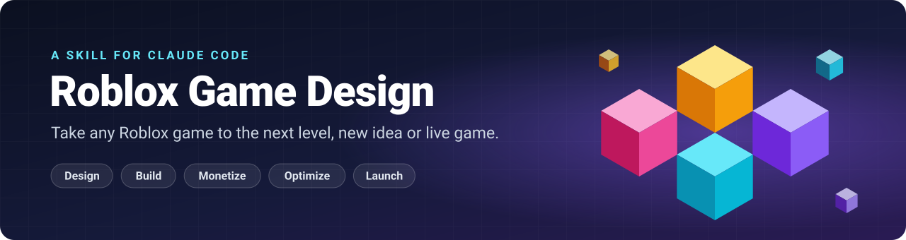
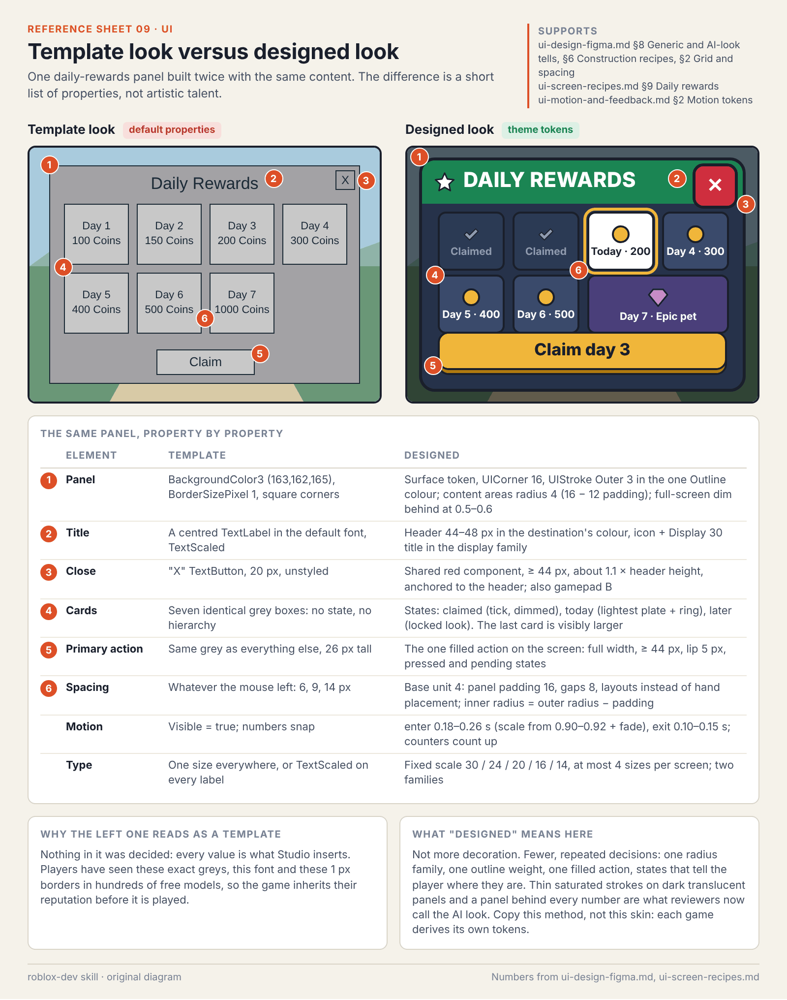

<p align="center">
  
</p>

<h1 align="center">Roblox Game Design Skill</h1>

<p align="center">
  <b>One skill that helps Claude take any Roblox game to the next level.</b><br>
  Brand-new idea or a game that's already live. Beginner or expert.
</p>

---

## What is this?

It's a skill for [Claude Code](https://claude.com/claude-code). A skill is a pack of instructions and knowledge that Claude reads when it needs it.

Install this one, then talk to Claude about your Roblox game like you normally would. Claude now knows how good Roblox games are designed, built, monetized, kept fast and kept safe, and it follows a checklist instead of guessing.

## It works three ways

| You have... | You say... | Claude does... |
|---|---|---|
| 💡 **An idea** | "I want to make a pizza delivery tycoon" | Plans the game with you step by step, then builds it in the right order |
| 🎮 **A game already** | "Review my game and make it better" | Audits it, scores it in 10 areas, and gives you a ranked to-do list, then starts fixing the top items |
| 🔧 **One problem** | "My players lose their coins sometimes" | Goes straight to the right guide and fixes that one thing |

## Install

### Best way: as a plugin, inside Claude Code

Type these two lines in Claude Code:

```text
/plugin marketplace add jestermaxdelta/roblox-building-skill
```

```text
/plugin install roblox-dev@roblox-game-design
```

Then run `/reload-plugins` (or restart Claude Code). Done.

On newer versions of Claude Code (2.1.275 and up) one line does both:

```text
/plugin install roblox-dev --marketplace jestermaxdelta/roblox-building-skill
```

**Why the plugin is better:** it installs 14 small skills instead of one big one. When you say "my game is laggy", Claude loads only the performance skill and the guides for that topic, so answers come faster and less context is wasted.

**To update:** run `/plugin marketplace update roblox-game-design`, then `/reload-plugins`. Or open `/plugin`, go to Marketplaces, and switch on auto-update.

### Other way: as a single skill

```bash
git clone https://github.com/jestermaxdelta/roblox-building-skill.git ~/.claude/skills/roblox-game-design
```

Restart Claude Code. This gives you the same knowledge as one large skill. To update it:

```bash
cd ~/.claude/skills/roblox-game-design && git pull
```

Use one way or the other, not both.

## How to use it

Just talk to Claude about your Roblox game. The right skill turns on by itself.

## Trigger words

You don't need to remember commands. Describe the problem in your own words and Claude picks the matching skill, reads only the guides for that topic, tells you what's wrong, recommends fixes in order, and then **starts fixing the top ones right away**. It only stops to ask before something that's hard to undo, like publishing, changing saved player data, or setting real prices.

| Say something like... | Skill that wakes up | What Claude does |
|---|---|---|
| "Make my game better" · "Review my game" · "Why isn't it growing?" | `level-up` | Audits the whole game, scores 10 areas, gives a ranked to-do list, starts on the top items |
| "Players leave after a minute" · "Nobody comes back" · "It's boring" · "The tutorial is bad" | `retention` | Finds where players drop off and fixes the first minute, the core loop and the reasons to return |
| "My monetization is bad" · "It isn't making money" · "What should I sell?" · "Set my prices" | `monetization` | Recommends products and prices for your genre, builds the shop and safe purchase code, times offers so they never annoy |
| "My UI looks bad / generic" · "The menu is broken on phone" · "Make a shop screen" | `ui` | Studies real reference screens first, redesigns yours phone-first (with Figma if you use it), builds it, checks text and button sizes |
| "The VFX is bad" · "Combat feels flat" · "No impact" · "The sounds are annoying" | `vfx-and-audio` | Adds readable effects, hit timing, camera feedback and sound, within a phone's limits |
| "Make a cutscene" · "Add a boss intro" · "The camera looks robotic" · "Make a trailer" | `cinematics` | Plans the shots, builds a short skippable scene with smooth camera paths, and puts everything back afterwards |
| "My game looks generic / like AI slop" · "My map feels empty" · "The lighting looks flat" | `world-and-lighting` | Finds what makes it look generic, sets one clear art direction, fixes layout, landmarks and lighting |
| "My models look bad" · "The style doesn't match" · "The animation is broken" | `models-and-animation` | Improves models in Blender, exports them correctly with collision, fixes rigs and animation |
| "Make an inventory" · "Add pets" · "Build a round system" · "Add trading" | `systems` | Builds the system safely: server-checked, saved properly, fitted to your game |
| "It's broken" · "I get this error" · "Works in Studio but not in the real game" | `debug` | Reproduces the bug, finds the real cause, fixes it and leaves a test |
| "My game is laggy" · "It crashes on phones" · "Low FPS" | `performance` | Measures, finds the biggest cost, fixes it, measures again |
| "Exploiters are ruining it" · "Players duped items" · "Players lost their data" · "They paid and got nothing" | `security-data` | Locks down remotes, saving and purchases; walks you through an incident |
| "Nobody plays my game" · "Make a thumbnail" · "Should I run ads?" · "I'm launching" | `growth` | Improves thumbnail, title and discovery, plans launch and marketing, checks you're ready |
| "I want to make a game" · "What should I build?" · anything else | `roblox-game-design` | The full playbook: plans a whole game step by step and builds it in the right order |

Want a specific skill? Type its name with a slash, for example `/roblox-dev:monetization` or `/roblox-dev:level-up`. If you installed the single skill instead, use `/roblox-game-design`: it has the same trigger table built in.

## Examples

**"Make my game better"** (works on a finished game)

> Here's my simulator. It gets 200 players a day but most leave in 2 minutes. What's wrong?

Claude looks at your game and your numbers, finds where players drop off, and fixes the biggest leak first. It won't tell you to rebuild everything when three fixes would do.

**"I have a new idea"**

> I want to make a Roblox tycoon where you run a pizza delivery company. Ages 9 to 14, mostly mobile. I'm solo and want a first version in 4 weeks.

Claude writes a one-page plan, designs the first 5 minutes so players get a reward in 30 seconds, works out prices and upgrade costs with real numbers, then builds one small playable loop before anything else.

**"I don't know what to make"**

> What Roblox game should I build next? I like simulators.

Claude checks what's trending and what's overcrowded, then gives you one safe pick and one bold pick, with reasons.

**"Help me earn from my game"**

> Add monetization to my simulator. It has egg hatching.

Claude plans boosts, a starter pack, gift passes and convenience passes, times offers so they never annoy players, shows odds the way Roblox requires, and writes purchase code that never charges twice or loses a purchase.

**"Design my UI"**

> My shop menu looks cheap and breaks on phones.

Claude designs it phone-first (in Figma if you use it), builds it in Roblox, and checks text size, button size and safe areas.

**"It's laggy" / "It's broken" / "Is it safe?"**

> My game crashes on phones. · My remote can be exploited. · I'm launching Saturday, am I ready?

Claude runs the matching checklist and fixes problems in order of impact.

## What it knows

| | |
|---|---|
| 🎯 **Game design** | Core loops, first-time experience, progression, what makes players come back |
| 🗂️ **21 genre playbooks** | Tycoon, simulator, pet collecting, obby, horror, RPG, fighting, tower defense, roleplay, survival, shooter, racing, fishing and more |
| 🔍 **Real game teardowns** | How 18 hit games actually work, and why some collapsed |
| 💰 **Monetization** | What to sell, what to charge, when to offer it, and Roblox's rules |
| 📈 **Economy** | Currencies, upgrade costs, rebirths, luck odds, trading, inflation |
| 🎨 **Art direction** | How to give a game its own look, and the exact things that make a game look generic or AI-made, with the fix for each |
| 🖼️ **UI and Figma** | Design systems, screen recipes (HUD, shop, inventory, settings), animation, phone layouts |
| 🧊 **Blender art** | Modelling well, exporting to Roblox, collision, textures, rigs and animation |
| ✨ **Feel** | Visual effects (with 21 build recipes), sound, music, camera, lighting, level design |
| 🎬 **Cutscenes and tutorials** | Short skippable cinematics with smooth cameras; tutorials that teach by playing |
| 🧭 **Icons and thumbnails** | What earns clicks honestly, tested at the sizes players really see |
| 🧱 **Game systems** | 24 ready designs: inventory, shop, pets, quests, combat, rounds, trading, leaderboards... |
| 💻 **Code** | Luau from first script to expert, project structure, physics and vehicles, debugging |
| 🛡️ **Security and saving** | Stopping exploiters, never losing player data, safe purchases |
| ⚡ **Performance** | Making it run on cheap phones |
| 📊 **Growth** | Analytics, the Roblox algorithm, thumbnails, ads, TikTok and YouTube, launch |
| 🤝 **People** | Accessibility, community and moderation, child safety, teams and business basics |

## A library of things to look at

Good-looking games are built from references, not from memory. So the skill ships with a visual library, and Claude studies a few examples that fit your game before it designs anything.

- **22 original reference sheets** come with the skill: annotated diagrams for HUD layout, shop screens, buttons, colour, effect timing, camera shots, lighting, level metrics and more. Claude can open them at any time, even offline.
- **About 690 curated references** across 13 topics (HUDs, menus, effects, cutscenes, tutorials, maps, models, lighting, animation, sound, icons and thumbnails). Each one has a note saying exactly what to study in it. Roughly 400 are images the curators actually looked at before listing them; weak, generic or AI-looking examples were thrown out.
- These are for **studying, never for copying**. Other people's images stay theirs: the library links to them and does not include them.

<p align="center">
  
</p>
<p align="center"><sub>One of the bundled sheets: the same panel built two ways, with the exact property differences.</sub></p>

## Built for every level

- **🌱 New to this?** Claude explains one thing at a time, keeps your first game small, and gives you safe code ready to use.
- **🔨 Made a game before?** Claude shows you what separates a working game from a good one: structure, data safety, mobile, polish.
- **🚀 Running a live game?** Claude gets to the point: numbers, trade-offs, experiments and step-by-step runbooks.

You don't pick a level. Claude works it out from how you talk and what your project looks like.

## Rules the skill always follows

1. **Every 3D model is made in Blender.** No basic Roblox parts and no free marketplace models in the finished game.
2. **Everything is solid.** Players can't walk through walls, props or buildings.
3. **Lots to buy, but never annoying.** Offers are small, easy to close and never block play. No fake discounts, fake countdowns or fake "limited stock".

These are the owner's house rules. If your existing game breaks them, Claude lists that as something to fix over time. It doesn't refuse to help.

## What to tell Claude (the more, the better)

| Tell it | Example |
|---|---|
| Your idea or your game | "You run a pizza delivery empire" |
| Genre | Tycoon, simulator, obby, horror, RPG |
| A similar game | "Like Restaurant Tycoon 2" |
| Who plays it | "Ages 9 to 14, mostly on phones" |
| Your time and team | "Solo, 4 weeks" |
| Your numbers, if it's live | Players per day, how long they stay, how many come back |
| Luck mechanics? | Yes or no |
| Where it is | New idea, prototype or live game, plus your project folder |

If you leave something out, Claude picks a sensible default and tells you.

## What you need

- [Claude Code](https://claude.com/claude-code)
- Roblox Studio. Connect the Studio MCP so Claude can look at your game, build and playtest
- Blender, if you want Claude to help make models
- Figma, if you want to design UI there (optional)

**Tip:** keep the planning files Claude writes in your game's `docs/` folder. Claude doesn't remember between chats, but it reads those files to pick up where you left off.

## What's inside

| Path | What it is |
|---|---|
| `SKILL.md` | The main skill: the three modes, the rules, and the trigger table. Kept short on purpose |
| `skills/` | The 13 focused skills (level-up, retention, monetization, ui, vfx-and-audio, cinematics, world-and-lighting, models-and-animation, systems, debug, performance, security-data, growth). Each is short and points at its own guides |
| `.claude-plugin/` | What makes this installable as a plugin |
| `references/` | 48 topic guides, plus `INDEX.md` (which guide to open for which job). Each guide starts with a "start here by level" table and ends with a checklist |
| `references/genres/` | 21 genre playbooks |
| `references/visual-library/` | The curated reference library, one file per topic |
| `assets/reference/` | The 22 bundled reference sheets, with their sources |
| `templates/` | Fill-in documents: audit report, one-page plan, design doc, economy sheet, product plan, analytics plan, playtest plan, launch checklist |
| `scripts/` | Ready-to-run helper scripts (Blender export and checks, thumbnail tile test) |
| `CREDITS.md` | Where the knowledge comes from |

## Where the knowledge comes from

- **Roblox's official Creator Docs**, for every platform fact
- **31 open-source repositories**, for the original knowledge base
- **The owner's market research**, a November 2026 snapshot of what's winning on Roblox
- **[LihFolk Vault V2](https://github.com/lihfolk-cy/v2-vault)** (CC BY 4.0), compared against our research and credited wherever we learned from it
- **The Roblox DevForum and RealtimeVFX**, read directly: tutorials, staff announcements, and threads where experienced developers critique each other's work
- **Game-craft writing and talks from outside Roblox** (UI, effects, animation, cinematography, onboarding), where the principles carry over

**Checked, not just collected.** After the research, every guide was reviewed again against the Roblox docs at the source: wrong facts were corrected, code sketches were read line by line, duplicates were merged and weak text was cut.

Honest limits: prices, limits and policies on Roblox change, so the skill tells Claude to re-check those against the live docs. Tips from the community are marked as tips, not facts. Code examples were reviewed by reading but never run, so treat them as starting points to test. Reddit could not be read directly, so anything from there came through search results. Business and legal notes are facts with dates, not legal advice.

Full details in [CREDITS.md](CREDITS.md).

---

<p align="center"><sub>Not affiliated with or endorsed by Roblox Corporation, the Blender Foundation or Figma.</sub></p>
